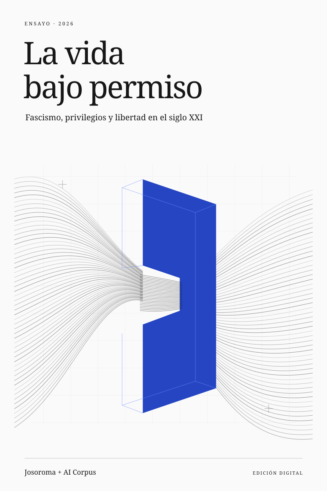

<p align="center">
  <a href="https://josoroma.github.io/la-vida-bajo-permiso">
    <picture>
      <source media="(prefers-color-scheme: dark)" srcset="arte/portada-dark.svg">
      
    </picture>
  </a>
</p>

# La vida bajo permiso

**Fascismo, privilegios y libertad en el siglo XXI.**

Un libro digital en español sobre el fascismo y las formas en que el privilegio, la vigilancia y las alianzas entre empresas y Estado convierten la libertad en permiso.

**[Leer el libro →](https://josoroma.github.io/la-vida-bajo-permiso)** · [Repositorio](https://github.com/josoroma/la-vida-bajo-permiso)

**16 capítulos · 75 páginas de lectura · 17 diagramas**

Historia y análisis hasta 2026, con fuentes documentadas. Explora las ideas con diagramas interactivos y lee a tu ritmo con búsqueda, marcadores y temas claro y oscuro.

Por **Josoroma + AI Corpus**. Para **Isa Orozco Gros-Desormeaux**.

<details>
<summary>Ejecutar en local</summary>

Requiere Node.js 22 o posterior. Sin instalación de dependencias.

```sh
npm run dev
```

Abre [localhost:4173](http://localhost:4173). Para construir y comprobar la edición: `npm run verify`.

</details>
